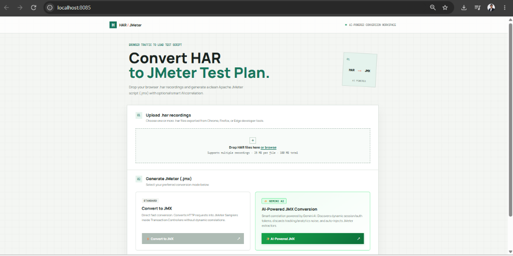
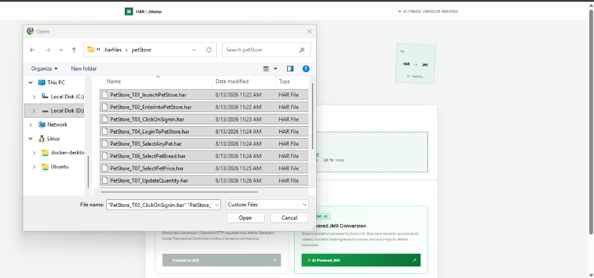
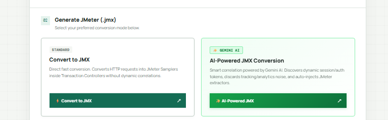
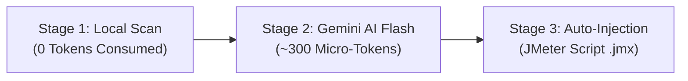
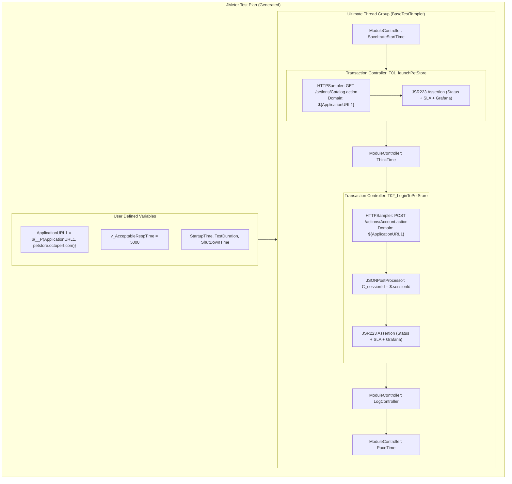
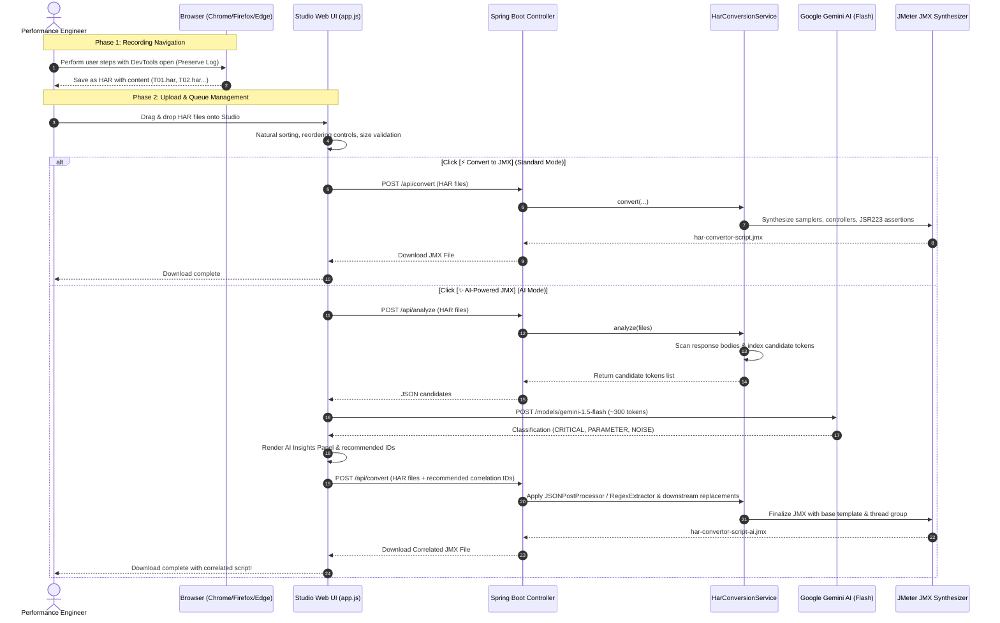
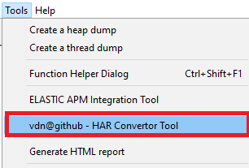

# HAR to JMeter Studio & Convertor Plugin

[](https://central.sonatype.com/artifact/io.github.vdaburon/har-convertor-jmeter-plugin)
[](https://github.com/vdaburon/CreateHtmlForFilesInDirectory/blob/main/LICENSE)
[](https://www.docker.com/)
[](https://jmeter.apache.org/)
[](https://ai.google.dev/)

An enterprise-grade platform to **convert browser HTTP Archive (`.har`) recordings directly into production-ready Apache JMeter Test Plans (`.jmx`)**. 

Whether you are converting single or multiple browser user interactions, this tool automates transaction creation, domain parameterization, workload schedule generation, **smart AI token correlation with Google Gemini**, and automated **JSR223 Groovy Assertions** designed for enterprise APM and Grafana monitoring.

---

## Table of Contents
- [1. Web UI Overview](#1-web-ui-overview)
- [2. Multiple HAR Upload & Transaction Grouping](#2-multiple-har-upload--transaction-grouping)
- [3. Conversion Modes: Standard vs AI-Powered](#3-conversion-modes-standard-vs-ai-powered)
  - [Option A: Standard Convert to JMX](#option-a-standard-convert-to-jmx)
  - [Option B: Gemini AI-Powered JMX Conversion](#option-b-gemini-ai-powered-jmx-conversion)
  - [Feature Comparison Matrix](#feature-comparison-matrix)
- [4. Under The Hood: How Conversion Works](#4-under-the-hood-how-conversion-works)
  - [Rules & Best Practices to Record Clean .HAR Files](#rules--best-practices-to-record-clean-har-files)
  - [Transaction Structure & Domain Parameterization](#transaction-structure--domain-parameterization)
  - [Automated JSR223 Groovy Assertions Engine](#automated-jsr223-groovy-assertions-engine)
- [5. End-to-End Architecture](#5-end-to-end-architecture)
- [6. Quick Start Guide](#6-quick-start-guide)
  - [Run with Docker Compose](#run-with-docker-compose-recommended)
  - [Run Standalone JAR (Spring Boot)](#run-standalone-jar)
  - [Run as JMeter GUI Plugin or CLI](#run-as-jmeter-gui-plugin-or-cli)
- [7. Configuration & Environment Variables](#7-configuration--environment-variables)
- [8. Release Notes](#8-release-notes)
- [9. References & Upstream Library](#9-references--upstream-library)

---

## 1. Web UI Overview

The **HAR to JMeter Studio** provides an interactive, dark/light studio interface designed for performance engineers and QA teams.



### Key Interface Features
* **Zero-Setup Studio Workspace**: Access the local web app on `http://localhost:8085` (or configured Docker port).
* **Multi-Transaction Queue**: Visual list showing each uploaded transaction step (`T01`, `T02`, `T03`, etc.), file size, and transaction order.
* **Transaction Reordering**: Instant **Up** / **Down** move buttons to reorder transaction steps before generation.
* **Real-Time Live Status Feedback**: Multi-phase progress indicators (local parsing, token indexing, Gemini classification, JMX synthesis).
* **Interactive AI Insights Panel**: Displays dynamic tokens discovered, extraction paths (`JSONPath` or `Regex`), route associations, and classification badges (`CRITICAL`, `PARAMETER`, `NOISE`).

---

## 2. Multiple HAR Upload & Transaction Grouping

Performance test scenarios typically represent a multi-step user journey (e.g., *Launch Store &rarr; Browse Category &rarr; Select Pet &rarr; Login &rarr; Checkout*). The Studio natively supports uploading **multiple `.har` files simultaneously**.



### How to Upload
1. **Drag and Drop**: Drag one or more `.har` files exported from your browser into the dashed drop zone.
2. **File Explorer**: Click **"browse"** to open your native file dialog and multi-select recordings (e.g., `PetStore_T01_launchPetStore.har`, `PetStore_T02_EnterIntoPetStore.har`, etc.).
3. **Queue Reordering**: If transactions appear in a different order, use the **Up** / **Down** controls on the queue rows to align the execution sequence.

### Upload Limits & Validation
* **Supported file types**: `.har` (JSON-compliant HTTP Archive recordings).
* **Per-file limit**: Up to **25 MB** per individual `.har` file.
* **Combined limit**: Up to **100 MB** total per conversion batch.
* **Integrity check**: Files are checked for valid HTTP request/response entries. Empty or corrupted files are detected immediately.

### Automatic Transaction Controller Mapping
When multiple `.har` files are submitted, the backend merges them into an ordered scenario. Each file is mapped into a dedicated **JMeter Transaction Controller**:
* `PetStore_T01_launchPetStore.har` &rarr; `T01_launchPetStore`
* `PetStore_T02_EnterIntoPetStore.har` &rarr; `T02_EnterIntoPetStore`
* `PetStore_T03_ClickOnSignin.har` &rarr; `T03_ClickOnSignin`
* `PetStore_T04_LoginToPetStore.har` &rarr; `T04_LoginToPetStore`

All Transaction Controllers have `Generate parent sample = true` enabled, giving clear rollup metrics in JMeter listeners and dashboards.

---

## 3. Conversion Modes: Standard vs AI-Powered

The studio offers two dedicated conversion engines depending on your script requirements:



### Option A: Standard Convert to JMX

```
Button: [⚡ Convert to JMX]
Output: har-convertor-script.jmx
Speed: < 1 second (Deterministic local processing)
```

#### What It Does
* **Direct Fast Conversion**: Synthesizes the raw HTTP requests into JMeter `HTTPSamplerProxy` elements.
* **Transaction Grouping**: Preserves transaction naming and step sequence inside Transaction Controllers.
* **Domain Parameterization**: Extracts base hosts into User Defined Variables (`${ApplicationURL1}`, `${ApplicationURL2}`, etc.).
* **Enterprise Assertions**: Injects JSR223 Groovy response & SLA assertions into every HTTP sampler.
* **Template Integration**: Embeds pacing, think-time, and Ultimate Thread Group elements.

#### When to Choose Standard
* When testing internal APIs with static test fixtures or pre-shared tokens.
* When you prefer to correlate dynamic tokens manually in JMeter GUI.
* When internet connectivity or AI API keys are unavailable.

---

### Option B: Gemini AI-Powered JMX Conversion

```
Button: [✨ AI-Powered JMX]
Output: har-convertor-script-ai.jmx
Engine: Hybrid Local Candidate Extraction + Google Gemini AI Flash Classifier
```

#### What It Does
Dynamic authentication tokens, bearer JWTs, session cookies, and business IDs change on every execution. The AI engine discovers and correlates these dynamic tokens automatically across downstream requests through a **3-stage pipeline**:



1. **Stage 1 &mdash; Local Candidate Discovery (Zero Tokens Consumed)**:
   * The backend scans all response bodies (JSON and HTML) across all HAR transactions for candidate dynamic values (alphanumeric tokens &ge; 8 characters, numeric IDs &ge; 6 digits, UUIDs, JWT headers `eyJ...`).
   * It cross-references downstream request headers, query parameters, and JSON payloads to find exact matches.
   * Resolves token paths (`JSONPath` expressions such as `$.data.token` or boundary regexes).

2. **Stage 2 &mdash; Gemini AI Classification & Noise Filtering**:
   * A compact payload (~300 tokens) is sent to **Gemini 1.5 Flash**.
   * Gemini classifies candidates into three strategic categories:
     * 🛡️ **`CRITICAL` (Auth / Security)**: Bearer tokens, JWTs, OAuth authorization codes, CSRF tokens (`_csrf`, `authenticity_token`), Session IDs (`JSESSIONID`, `PHPSESSID`). *Auto-correlated.*
     * 📦 **`PARAMETER` (Business Entities)**: Order IDs, Cart IDs, Customer/Account numbers created in earlier steps and reused downstream. *Auto-correlated.*
     * 🔇 **`NOISE` (Telemetry & Analytics)**: Google Analytics (`_ga`, `_gid`), DoubleClick, Datadog/Sentry beacons, New Relic pings, cache-busting timestamps. *Filtered out to keep scripts clean.*

3. **Stage 3 &mdash; Auto-Injection into JMX**:
   * Injects `JSONPostProcessor` (for JSON responses) or `RegexExtractor` (for HTML/text) on the source HTTP sampler.
   * Variables are assigned clean naming: `${C_bearerToken}`, `${C_csrfToken}`, `${C_sessionId}`, `${C_orderId}`.
   * Downstream samplers, URLs, request headers, and payloads have raw values replaced with the variable reference `${C_varName}`.
   * Displays the **AI Correlation Insights** panel in the Web UI:

```
✨ AI Analysis Complete: Automatically correlated 5 dynamic variables and ignored 12 analytics/tracking tokens.
  [✓] C_bearerToken   | CRITICAL  | JSON: $.auth.token  | T01_Login -> T02_UserProfile
  [✓] C_csrfToken     | CRITICAL  | Regex               | T01_Login -> T03_UpdateCart
  [✓] C_orderId       | PARAMETER | JSON: $.order.id    | T03_Checkout -> T04_Confirmation
  [ ] _ga_UA12345     | NOISE     | Filtered            | Ignored tracking pixel
```

---

### Feature Comparison Matrix

| Feature | Standard Convert (`⚡`) | AI-Powered JMX (`✨`) |
|---|:---:|:---:|
| **Processing Speed** | Instant (< 1s) | Fast (~2 to 3s) |
| **Transaction Controllers Created** | ✅ Yes | ✅ Yes |
| **Domain Parameterization (`${ApplicationURL}`)** | ✅ Yes | ✅ Yes |
| **JSR223 Groovy Assertions (SLA + APM)** | ✅ Yes | ✅ Yes |
| **Workload Schedule (Ultimate Thread Group)** | ✅ Yes | ✅ Yes |
| **Dynamic Token Discovery** | ❌ Manual | ✅ Automatic |
| **JSONPath Extractor Injection** | ❌ Manual | ✅ Automatic (`JSONPostProcessor`) |
| **Regex Extractor Injection** | ❌ Manual | ✅ Automatic (`RegexExtractor`) |
| **Downstream Variable Replacement** | ❌ Manual | ✅ Automatic (`${C_token}`) |
| **Noise & Analytics Filtering** | ❌ Manual | ✅ Automatic (Google Analytics, Sentry, etc.) |
| **Requires Gemini API Key** | ❌ No | ⚠️ Optional (has built-in heuristic fallback) |

---

## 4. Under The Hood: How Conversion Works

### Rules & Best Practices to Record Clean .HAR Files

To ensure the highest script quality and avoid false positives during correlation, follow these recording rules:

1. **Use an Incognito / Private Window**:
   * Eliminates cached cookies, saved sessions, and background browser extensions (e.g., password managers, ad-blockers) from polluting the network log.
2. **Open Developer Tools (`F12`) & Navigate to the Network Tab**:
   * Make sure the record button (red dot) is active.
3. **Enable "Preserve Log"**:
   * Prevents DevTools from clearing traffic upon HTTP 302 redirects or page reloads.
4. **Enable "Disable Cache"**:
   * Forces the browser to download all dynamic assets and API responses realistically, simulating a fresh user session.
5. **Record Transaction by Transaction**:
   * Clear the network log (trash/clear icon) before initiating an action.
   * Perform the action (e.g., click *Sign In*).
   * Wait for network traffic to settle.
   * Right-click any network entry &rarr; select **"Save all as HAR with content"**.
   * Name your file with sequential transaction identifiers:
     * `App_T01_OpenHome.har`
     * `App_T02_SearchProduct.har`
     * `App_T03_AddToCart.har`
     * `App_T04_Checkout.har`
6. **Always Save "With Content"**:
   * JMeter correlation and assertion generation require HTTP response bodies. Do not export HAR files without response payloads.

---

### Transaction Structure & Domain Parameterization

When files are processed, the converter enforces strict load testing best practices:



1. **Host Extraction**: All distinct server hostnames are extracted and replaced with configurable variables:
   * `https://api.example.com/v1/auth` &rarr; `HTTPSampler.domain = ${ApplicationURL1}`
   * In User Defined Variables: `ApplicationURL1 = ${__P(ApplicationURL1, api.example.com)}`. This allows overriding environments at runtime via CLI (e.g., `-JApplicationURL1=staging.example.com`).
2. **Redirect Strategy**: Automatically sets `follow_redirects = true` for safe navigation while handling 302 redirects without infinite loops (`auto_redirects = false`).
3. **Pacing and Think Time**: Seamlessly incorporates modular pacing controllers (`PaceTime`, `PaceingInterval`) and user delay controllers (`ThinkTime`).

---

### Automated JSR223 Groovy Assertions Engine

Every generated HTTP Sampler is equipped with an automated **JSR223 Groovy Assertion**. This assertion provides 4 core validation layers without manual scripting:

```groovy
String TXN_NAME = "T01_launchPetStore"
String TEXT_CHECK = "Catalog"
String TEXT_CHECK1 = "Fish"

Set<String> OK_CODES = ["200", "201", "202", "204", "302"] as Set
int MAX_ERR_LEN = 500

String ST_PASS = "Pass"
String ST_SLOW = "Slow"
String ST_FAIL = "Fail"

String responseCode = prev.getResponseCode() ?: ""
String response = prev.getResponseDataAsString() ?: ""

// Strip characters that break Grafana ingestion
for (String ch : ['\r', '\n', ',', '-', '?', "'", '{', '}', '/', '"']) {
    response = response.replace(ch, "")
}

long loadTime = prev.getTime()
vars.put("LoadTime", String.valueOf(loadTime))

long acceptableRespTime = Long.MAX_VALUE
try {
    acceptableRespTime = Long.parseLong(vars.get("v_AcceptableRespTime") ?: "")
} catch (NumberFormatException e) {
    log.warn("v_AcceptableRespTime missing or not numeric, skipping slow check")
}

// Fields logged to Grafana / APM
vars.put("TransactionName", TXN_NAME)
vars.put("ResponseCode", responseCode)
vars.put("UniqueIdentifier", "Application ID: " + (vars.get("C_ApplicationID") ?: "NA"))
vars.put("ErrorMsg", "NA")

boolean codeOk = OK_CODES.contains(responseCode.trim())
boolean textOk = (TEXT_CHECK.isEmpty() || TEXT_CHECK.equals("NotFoundResponseData") || response.contains(TEXT_CHECK)) &&
                 (TEXT_CHECK1.isEmpty() || TEXT_CHECK1.equals("NotFoundResponseData") || response.contains(TEXT_CHECK1))

if (codeOk && textOk) {
    if (loadTime > acceptableRespTime) {
        vars.put("status", ST_SLOW)
        vars.put("ErrorMsg", "ResponseTime " + loadTime + " ms higher than " + acceptableRespTime + " ms")
    } else {
        vars.put("status", ST_PASS)
    }
    AssertionResult.setFailure(false)
} else {
    String msg
    if (responseCode.contains("Non HTTP response code")) {
        vars.put("ResponseCode", "ReceivedNonHTTPResponseCode")
        msg = "ReceivedNonHTTPResponseCode"
    } else if (!codeOk) {
        msg = "Unexpected response code: " + responseCode
    } else {
        msg = "Expected text not found: " + TEXT_CHECK + " / " + TEXT_CHECK1
    }
    vars.put("ErrorMsg", msg)
    vars.put("status", ST_FAIL)
    AssertionResult.setFailure(true)
    AssertionResult.setFailureMessage(msg)
}
```

#### What the Assertion Validates:
1. **HTTP Status Code Validation**:
   * Ensures the response code is within valid HTTP codes (`200`, `201`, `202`, `204`, `302`).
   * Catches network/DNS drops (`Non HTTP response code`) and marks them cleanly.
2. **Dual Dynamic Content Verification (`TEXT_CHECK`, `TEXT_CHECK1`)**:
   * Automatically identifies two non-stopword tokens from the recorded response (e.g., page titles, JSON status keys, button text).
   * Validates that the server returned meaningful business content rather than an empty 200 OK error page.
3. **SLA & Response Time Thresholds (`ST_SLOW`)**:
   * Checks `prev.getTime()` against `${v_AcceptableRespTime}` (default: 5000 ms).
   * Categorizes transactions as `Slow` if response time breaches SLA thresholds while keeping the assertion passing if data was valid.
4. **Grafana & APM Metrics Sanitization**:
   * Removes problematic delimiters (`\r`, `\n`, quotes, brackets) so response strings and error details can be ingested into **Grafana, InfluxDB, Prometheus, or Elasticsearch** without breaking log parsers.

---

## 5. End-to-End Architecture



---

## 6. Quick Start Guide

### Option 1: Run Pre-Built Image from Docker Hub (Fastest)

Run directly with Docker without compiling:

```bash
docker run -d -p 8085:8080 \
  -e GEMINI_API_KEY="your-gemini-api-key" \
  --name har-convertor \
  khaja7289/hartojmx:latest
```

* **Web UI URL**: [http://localhost:8085](http://localhost:8085)
* **Docker Hub Repository**: [khaja7289/hartojmx](https://hub.docker.com/repository/docker/khaja7289/hartojmx/general)

---

### Option 2: Run with Docker Compose

Clone the repository and launch the containerized application:

```bash
git clone https://github.com/vdaburon/har-convertor-jmeter-plugin.git
cd har-convertor-jmeter-plugin
docker compose up -d
```

* **Web UI URL**: [http://localhost:8085](http://localhost:8085)
* **View Logs**: `docker compose logs -f`
* **Stop Container**: `docker compose down`

To configure your **Google Gemini API Key** for server-side AI correlation, set it in [docker-compose.yml](file:///d:/git%20projects/har-convertor-jmeter-plugin/docker-compose.yml):

```yaml
environment:
  - PORT=8080
  - GEMINI_API_KEY=AIzaSyYourActualGeminiApiKeyHere
```

---

### Run Standalone JAR

Requires **Java 17+** and **Maven**:

```bash
cd webapp
mvn clean package -DskipTests
java -jar target/har-convertor-webapp-10.0.0.jar
```

The web server will start on `http://localhost:8080` (or the port defined by `PORT`).

---

### Run as JMeter GUI Plugin or CLI

#### 1. JMeter GUI Plugin
Install via the **JMeter Plugins Manager**:
1. Open JMeter &rarr; **Options** &rarr; **Plugins Manager**.
2. Search for `vdn@github - har-convertor-jmeter-tool`.
3. Click **Apply Changes and Restart JMeter**.
4. Open the plugin via: **Tools &rarr; vdn@github - HAR Convertor Tool**.



#### 2. Command Line Interface (CLI)
Automate script generation via shell scripts in `<JMETER_HOME>/bin`:

* **Windows**:
  ```cmd
  har-convertor-to-jmeter.cmd -har_in "recording.har" -jmx_out "output.jmx" -add_pause true -new_tc_pause 5000
  ```
* **Linux / macOS**:
  ```bash
  ./har-convertor-to-jmeter.sh -har_in "recording.har" -jmx_out "output.jmx" -add_pause true -new_tc_pause 5000
  ```

---

## 7. Configuration & Environment Variables

| Variable | Default | Description |
|---|---|---|
| `PORT` | `8080` | Internal HTTP listening port for Spring Boot. |
| `GEMINI_API_KEY` | *(empty)* | Optional Gemini API key for automated AI token correlation. If unset, the browser fallback heuristic operates with 0 token consumption. |
| `JAVA_OPTS` | `-XX:+UseContainerSupport -XX:MaxRAMPercentage=75.0` | JVM flags and memory allocations. |
| `FORWARD_HEADERS_STRATEGY` | `none` | Set to `framework` when deployed behind reverse proxies (Nginx, Traefik, AWS ALB). |

---

## 8. Release Notes

* **v10.0**: Added interactive Spring Boot Web UI Studio (`webapp`), multi-HAR transaction upload with drag-and-drop, automated Gemini AI token correlation, JSR223 Groovy Assertions engine with APM/Grafana sanitization, and Docker support.
* **v9.1 - 9.0**: Optimized Jackson parser buffer sizes (`jackson_parser_string_max`), upgraded Saxon-HE engine to 12.3+, removed deprecated browser extension hooks.
* **v8.0**: Added `-remove_headers` parameter to strip volatile HTTP request headers.
* **v7.0**: Added WebSocket sampling support using Peter Doornbosch's WebSocket Samplers plugin.
* **v5.0 - 6.0**: Added Transaction Controller creation from external CSV/JSON marker files, and integrated Results Tree recording XML viewers.

---

## 9. References & Upstream Library

This plugin and web studio build upon and integrate the following open-source projects:

* **[har-to-jmeter-convertor](https://github.com/vdaburon/har-to-jmeter-convertor)**: The core conversion engine and CLI tool developed by Vincent Daburon that powers the HAR parsing and JMX XML generation.
* **[DZone Technical Article: Convert a HAR file to JMeter script](https://dzone.com/articles/convert-a-har-file-to-jmeter-script)**: Author's in-depth article covering the motivations, architecture, and methodology.
* **[create-external-file-for-har](https://github.com/vdaburon/create-external-file-for-har)**: Helper utility for generating transaction marker CSVs from HAR recordings.
* **[WebSocket Samplers by Peter Doornbosch](https://bitbucket.org/pjtr/jmeter-websocket-samplers/src/master/)**: Used for generating WebSocket protocol samplers in JMeter.

---

## License

Licensed under the **Apache License, Version 2.0**. You may freely use, modify, and distribute this software for commercial and private use.
